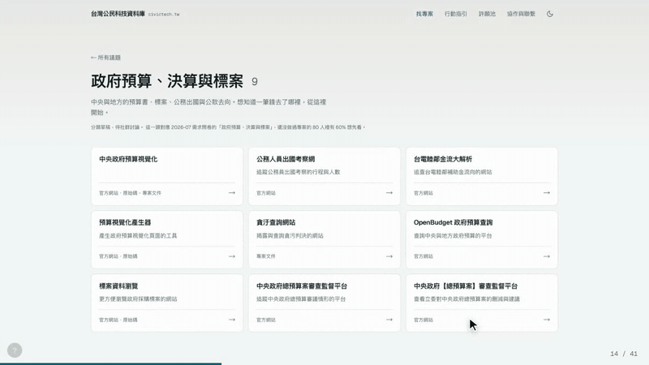
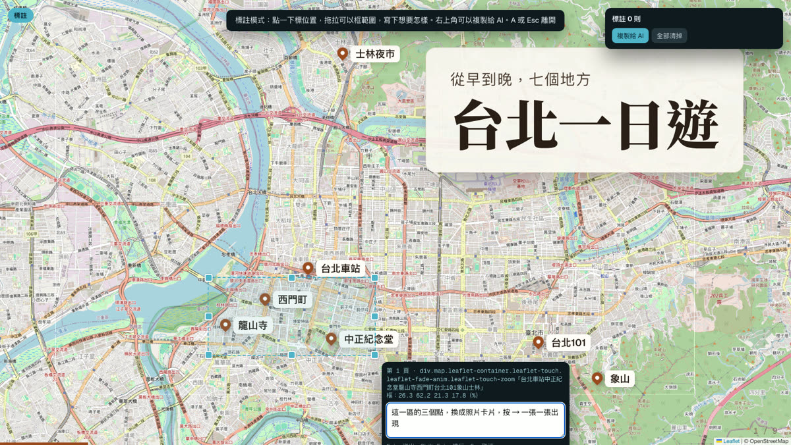
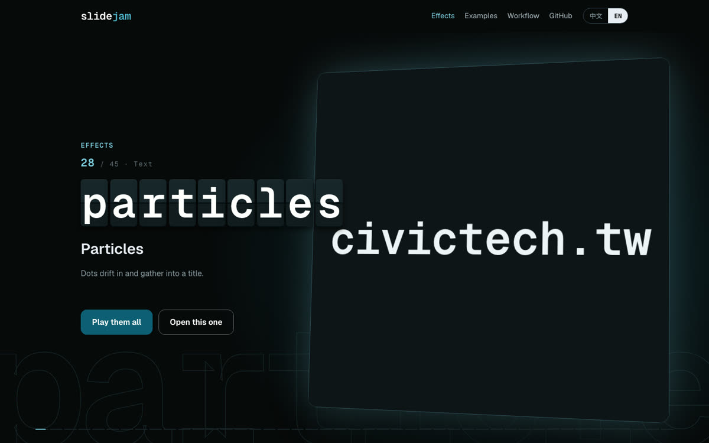
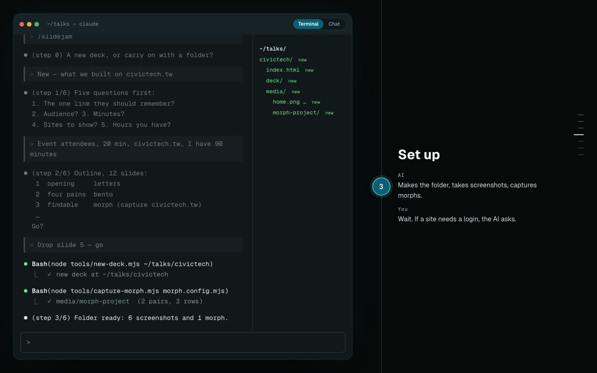

# slidejam

[English](README.md) · 中文

跟 AI 一起即興做簡報：會動的投影片，就在一個 HTML 檔裡。


slidejam 做出來的簡報就是一個 `index.html`。雙擊就能打開，不用編譯、不用伺服器，也不用任何框架。

它是為了「介紹一個網站」的演講做的。這種演講有三個需求：

- **用真網站做出換頁動畫。** 給一支小程式兩個網址，再告訴它要點哪裡，它就做出一段「點下去，頁面重組」的動畫：共用的元素會飛到新頁面上的位置。
- **把真地圖、真網站放進投影片。** 地圖會一個一個落下圖釘，在地點之間飛來飛去；真的網站可以放在瀏覽器或手機外框裡現場操作。
- **改字不用翻 HTML。** 按 **E** 直接在投影片上打字，按 **⌘S** 只把改過的文字寫回檔案。



*用 civictech.tw 做出的頁面重組動畫：點一張專案卡片，頁面就重組成專案頁。*

也有一套跟 AI 溝通的方法。按 **A**，在投影片上點一下或拖拉框出一塊，寫下你想要怎樣。框畫好之後還能拖動、調整大小。簡報會把你的標註整理成一份清單，附上元素的選擇器和座標，直接貼給 AI 就好。



🌐 網站：https://slidejam.pages.dev/ · [效果圖鑑](https://slidejam.pages.dev/effects/) · [範例](https://slidejam.pages.dev/play/) · [跟 AI 一起做的流程](https://slidejam.pages.dev/guide/)

📖 完整使用說明：[docs/使用說明.md](docs/使用說明.md)

## 快速開始

```sh
git clone … slidejam && cd slidejam
npm install                         # Playwright，只有截圖工具會用到
npx playwright install chromium-headless-shell
node tools/new-deck.mjs ~/talks/my-talk
open ~/talks/my-talk/index.html
```

打開 `effects.html`，可以看到每一種效果實際動起來的樣子，旁邊附上要寫的程式碼。

裝好 Claude Code 的 skill 之後（見[資料夾結構](#資料夾結構)），在 Claude Code 輸入 `/slidejam`，它會用六個步驟帶你做出一份新簡報。

## 按鍵

| 按鍵 | 作用 |
|---|---|
| → 或空白鍵 | 下一步、下一頁 |
| ← | 上一頁 |
| G 或點頁碼 | 總覽；按上方的「▶ 播放全部」，每一頁會同時動起來 |
| P | 講者視窗：講稿、下一頁和計時器，只在你自己的螢幕上 |
| T | 換主題：即時預覽每一套主題，⌘S 把選擇寫進檔案 |
| ? 或左下角的小按鈕 | 列出所有按鍵；點一列直接執行，點右邊的鍵可以換成別的鍵 |
| 滑到最下面的進度條 | 預覽那一頁，點一下就跳過去 |
| R | 重播這一頁 |
| N | 講稿 |
| F | 全螢幕 |
| E，再按 ⌘S | 直接改字，存回檔案（Chrome） |
| A | 標註：點一下或拖拉框選（框畫好後可以移動、調整大小），寫下想要怎樣，再複製清單給 AI |
| 左右滑、點畫面（觸控螢幕） | 左右滑翻頁；點一下前進，點左邊三分之一回上一頁 |


## 網站上

| [效果圖鑑](https://slidejam.pages.dev/effects/) | [範例](https://slidejam.pages.dev/play/) | [使用流程](https://slidejam.pages.dev/guide/) |
|---|---|---|
|  |  |  |
| 45 種效果輪流上台，每一種都附上「跟 AI 這樣說」 | 四份用 slidejam 做的簡報，都能在劇場裡播放 | 重播一段 Claude Code 對話，一步一步看 |

## 效果

在元素上加 `data-fx="名稱"` 就能套用效果：

| 分類 | 效果 |
|---|---|
| 文字 | `type` 打字 · `mark` 螢光筆 · `letters` 一個字一個字從模糊裡浮上來 · `rotate` 句子裡的一個詞輪流換 · `flap` 翻牌看板 · `particles` 粒子聚成標題 · `textmask` 用會漂動的圖片填滿文字 |
| 數字與資料 | `count` 數字往上跳 · `slot` 每一位數字各自滾動 · `bars` 長條圖 · `ring` 圓環進度 · `orbit` 沿著循環一站一站亮 · `network` 議題和專案組成會轉的立體星團 · `tunnel` 名字沿著隧道流過 · `swarm` 一大群東西衝進來就位 |
| 截圖 | `pan` 捲動長截圖 · `zoom` 推近 · `cycle` 淡入淡出輪播 · `spot` 一步一步打聚光燈 · `hotspots` 會跳動的圓點加說明 · `tilt` 立體傾斜 · `explode` 一層一層拆開並加標籤 · `parallax` 景深 · `dive` 鑽進一個點變成下一頁 · `wipe` 色帶掃過露出另一張 · `morph` 用真網站做出的頁面重組 |
| 操作導覽 | `clickpath` 游標一步一步點過截圖 · `story` 步驟清單和畫面同步 · `chat` 訊息一則一則跳出來 · `terminal` 指令自己打出來、結果一行行印出 · `live` 投影片裡放真的網站 · `map` Leaflet 地圖，落下圖釘、一站一站飛過去 |
| 版面 | `bento` 功能格狀總覽：格子從最近的畫面邊緣飛進來，格子裡的效果照樣在動（用 `w2`／`h2` 調整大小） · `pop` 依序彈出 · `compare` 分隔線在兩張圖之間來回掃 · `stack` 一疊卡片輪流換到最上面 · `assemble` 卡片飛進來排成格子 · `feature` 格子輪流當主角 · `collapse` 全部縮成最後一行 |

外框是一般的 class：`.browser`、`.phone`、`.tablet`、`.monitor`、`.laptop`，用 `.devices` 把它們排在一起。
想等按 → 才開始、不要自己動的效果，加上 `data-on="step"`。

有兩種行為不需要 `data-fx`：`data-i="n"` 決定出場順序；`data-step="n"`／`data-step-out="n"` 讓東西在每次按 → 時出現或離開。

## 做一段頁面重組動畫

```js
// morph.config.mjs
export default {
  out: "media/morph-project",
  from: { url: "https://example.org/list", click: 'a[href="/item/42"]' },
  to:   { url: "https://example.org/item/42" },   // 不寫的話就真的點下去
  pairs: [['a[href="/item/42"] h3', "h1"]],      // 從起點飛到終點的元素
  rows: "main section > *",                      // 依序浮上來的其他內容
  wait: "map",                                   // 頁面有地圖時要加
};
```

```sh
cd ~/talks/my-talk && node ~/slidejam/tools/capture-morph.mjs morph.config.mjs
```

最後在投影片裡加上 `<div class="morph" data-fx="morph" data-src="media/morph-project"></div>`。

## 不開瀏覽器也能檢查簡報

```sh
node tools/shoot.mjs ~/talks/my-talk/index.html --sheet     # 每一頁截一張，再拼成一張總表
node tools/shoot.mjs index.html 12 --at 0.5,2,4             # 同一頁在不同時間點各截一張
```

## 匯出成 PowerPoint 或 PDF

```sh
node tools/export.mjs ~/talks/my-talk/index.html --font "Noto Sans TC"         # 做出 index.pptx
node tools/export.mjs ~/talks/my-talk/index.html --font "Noto Sans TC" --pdf   # 做出 index.pdf
```

PowerPoint 檔裡，每張圖、每個框、每段字都是獨立的物件，在 Canva、Google 簡報、Keynote、PowerPoint 裡都能個別移動、複製、拿去別處用。PDF 的文字可以選取、搜尋。

匯出的是每一頁動畫跑完的樣子：影片會變成最後一格，加上 `--steps` 則每一步各自匯出成一頁。`--font` 換成對方軟體也有的字型，文字的位置和換行才不會跑掉。

## 資料夾結構

```
deck/        引擎：deck.css、deck.js（核心與各種模式）、fx/（每種效果一個檔，用到才載入）、themes/
template/    新簡報的 index.html
tools/       new-deck、capture-morph、shoot、export（PowerPoint 與 PDF）、thumbs（網站縮圖與海報）、shoot-og（og.png）
effects.html 效果圖鑑
examples/    範例簡報（intro、civictech、taipei）和圖鑑用的素材
skill/       跟 AI 一起做簡報用的 Claude Code skill
site/        網站（Astro，放在 Cloudflare Pages）
docs/        使用說明，以及 README 的圖片
```

要在 Claude Code 裡用這個 skill，執行
`ln -s "$PWD/skill" ~/.claude/skills/slidejam`。

## 授權

MIT
